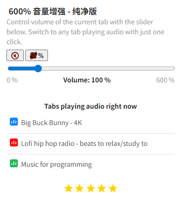

# 600% 音量增强 - 纯净版

基于原版 **600% Sound Volume Booster 3.1.2** 的最小去隐私改版。

**界面、快捷键、音量处理链路全部保留原版**；只移除会拉取/外传信息的代码和推广：
远程配置、隐藏 iframe 打点、安装后跳转、页面 localStorage 读取、Web Proxy 广告、旧商店/Google 表单链接。



> 个人使用的修改版，非原作者发布；原扩展版权归原作者。仓库默认私有。  
> 改名并移除了原 `key`，因此会生成**新的扩展 ID**，不再沿用被 Edge 拉黑的那个 ID。

---

## 改了什么

| # | 改动 | 位置 |
| --- | --- | --- |
| 1 | 删除安装后打开 `extaddon.site` 推广页 | `assets/chunk-0d040447.js` |
| 2 | 删除远程配置（`config.extaddon.site` 隐藏 iframe + postMessage） | `assets/chunk-0d040447.js`、`assets/chunk-3076fac0.js`、`assets/offscreen-4907ec25.js` |
| 3 | 删除命中站点时创建的 `tag` 隐藏 iframe（第三方打点） | `assets/offscreen-4907ec25.js` |
| 4 | 内容脚本不再读取页面的 `localStorage("tagged")`；`getTagged` 直接返回 `null` | `assets/chunk-dff47896.js` |
| 5 | `chunk-3076fac0.js` 重写：只保留本地 `chrome.storage.local` 读写 | `assets/chunk-3076fac0.js` |
| 6 | 隐藏 Web Proxy 广告、隐藏 Rate Us 提示；星标/提示链接改为本仓库 | `assets/chunk-e3c707d9.js` |
| 7 | 改名；删除 `manifest.key`、`update_url`、`_metadata`（商店签名） | `manifest.json`、`_locales/*` |
| 8 | 收紧 CSP：`connect-src 'self'`、`frame-src 'none'` | `manifest.json` |
| 9 | 未改：React 弹窗、内容脚本桥、tabCapture/offscreen 音量链路、快捷键、有声标签页列表、权限 | — |

改完后：

- 没有任何 `extaddon.site` / `config.extaddon.site` 地址；
- 不创建 iframe、不加载远程配置、不发送打点；
- 安装后不打开任何页面；
- 运行时不再有“上传/外发”的代码路径。

---

## 现在还会读取什么（全部只在本机）

为了保留原版功能，以下数据仍会被**本机**读取或保存，但不会发到网络：

- `tabs` 权限：当前标签页 URL（用于按站点记住音量、判断是否注入桥接脚本）；正在发声标签页的标题和图标（用于“Tabs playing audio right now”列表）。
- 内容脚本：只收发音量消息；不读 DOM、不读 `localStorage`、不请求网络。
- 弹窗：显示标签页图标时，浏览器会加载对应网站的 favicon（和原版一样，属于图片请求）。
- 音量值、提示使用次数：存在本机 `localStorage` / `chrome.storage.local`，不上传。
- 点击星标/提示里的链接会打开本仓库页面（不会自动请求）。

---

## 权限说明（沿用原版）

```json
"permissions": ["tabs", "tabCapture", "storage", "offscreen", "scripting"],
"host_permissions": ["<all_urls>"],
"content_scripts": [{ "matches": ["http://*/*", "https://*/*"], "all_frames": true, ... }]
```

这是**最小改动**的直接结果：原版用内容脚本作为弹窗与后台之间的桥；移除它需要重写弹窗/后台协议，超出“只去隐私拉取”的范围。

因此 Edge 仍会显示原版那几条权限提示（读浏览历史、读改所有网站数据）。区别是：代码里已经没有任何把页面数据或统计信息发出去的路径；内容脚本也不再读页面数据。介意权限面的话，可以再做一版无内容脚本/最小权限的重写。

---

## 安装

1. 打开 `edge://extensions`，开启 **开发人员模式**。
2. 点击 **加载解压缩的扩展**，选择本文件夹（`manifest.json` 所在目录）。
3. 建议在扩展列表里移除旧的 **600% Sound Volume Booster**。
4. 快捷键 `Ctrl+Shift+6` 打开弹窗；可固定到工具栏。

因为移除了 `manifest.key`，新扩展的 ID 不再等于原插件 ID，不会被原黑名单按 ID 拦截。
如果 Edge 提示“来自其他来源”，确认加载即可。

---

## 使用（与原版一致）

- 滑块 0–600%；`🔇` 静音；`💯%` 恢复 100%；数字键 0–6 直接设定。
- 鼠标滚轮在弹窗内可 ±10%；方向键可微调。
- 100% = 原始音量；600% ≈ +15.6 dB。
- “Tabs playing audio right now” 列出正在发声的标签页，点击可切换过去。
- 高增益出现破音是数字音频削顶，原版行为，本版没有加限幅（按你的意见不做改动）。

---

## 自查

在扩展目录里只扫描运行时代码（README 本身包含证据域名，排除）：

```powershell
Get-ChildItem . -Recurse -File -Include *.js,*.html,*.json,*.css |
  Where-Object { $_.FullName -notmatch 'README|_locales' } |
  Select-String -Pattern 'extaddon|config\.extaddon|forms\.gle|web-proxy|halhikgflghgbhpkdmlplhdcepenjlgi|tagFrame|configFrame|offscreenTag|loadExtConfig|localStorage\.getItem\("tagged"\)'
```

预期无输出。

再确认没有安装跳转：

```powershell
Select-String -Path assets\*.js -Pattern 'chrome\.tabs\.create'
```

预期无输出。

说明：`assets/chunk-3cfb730f.js` 里有 Vite 的 modulepreload polyfill，包含一个同源 `fetch()`（只在浏览器不支持 modulepreload 时使用），不涉及外网，也不读取页面数据。

---

## 原版恶意行为证据（供对照）

原扩展在本机 Edge 的 `Secure Preferences` 中：

- `blacklist_state: 1`
- `acknowledged_blocklist_state: 1`
- `disable_reasons: 256`

原版代码里：

1. **安装跳转**：`chrome.runtime.onInstalled` → `chrome.tabs.create({ url: "https://extaddon.site/600-sound-volume/edge/" })`。
2. **远程配置**：offscreen 创建隐藏 sandbox iframe 加载 `https://config.extaddon.site/?rnd=...`，通过 `postMessage` 取配置。
3. **静默打点**：内容脚本命中配置中的站点时，创建隐藏 iframe 请求 `https://config.extaddon.site/tag/?v=3.1.2&id=<uid>&rnd=...`，用 `localStorage("tagged")` 限制每天一次。
4. **推广**：弹窗含 Web Proxy 推广、旧商店评分、Google 表单链接。

音量增强本身（`tabCapture` + `GainNode`）一直是本地的；问题在于上面这些夹带。本改版已把它们全部移除。

---

## 文件

```
manifest.json
popup.html / popup.css
offscreen.html
service-worker-loader.js
assets/                   # 原版打包产物（已修改）
images/                   # 原版图标
_locales/                 # 已改名
screenshot.png
README.md
```

无构建步骤；直接加载本文件夹。

---

## 来源与声明

- 基于原版 3.1.2 的修改版，仅供个人使用；原扩展及其素材版权归原作者。
- 未获得原作者授权，未声明开源许可证；请勿用于商店重新发布或商业分发。
- 仓库默认私有；如需公开或二次修改，请自行确认版权与合规。
